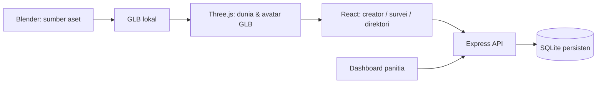
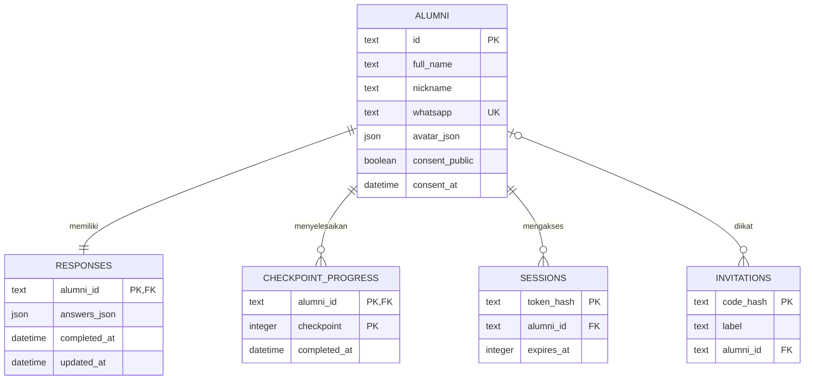

# Arsitektur & data

## Keputusan implementasi

Next.js App Router + React + TypeScript untuk antarmuka dan route API Node.js. Three.js melalui React Three Fiber untuk dunia; SQLite Node 24 menyimpan data di disk persisten. API memakai Web Request/Response langsung dalam server Next.js standalone. Express hanya adapter opsional untuk CLI/pengujian, dengan handler yang sama; tidak ada proxy atau proses API tambahan. Halaman panitia dimuat dalam bundle /admin terpisah.

## Relasi database

Jawaban menggunakan objek JSON dengan whitelist nilai dan validasi per checkpoint di `server/domain.mjs`. Ini menjaga kontrak sederhana untuk tujuh checkpoint tetap sambil memungkinkan ekspor. Kolom status final terpisah dari JSON; progres memakai primary key gabungan agar satu checkpoint tidak dihitung dua kali. SQLite menyediakan constraint JSON valid, foreign key, dan nomor WhatsApp unik. Untuk analitik besar, pindahkan jawaban kategori ke tabel/kolom bertipe dan agregasikan melalui SQL.

## Kontrak jawaban

| Checkpoint | Kunci                  | Bentuk                                     |
| ---------- | ---------------------- | ------------------------------------------ |
| 0          | concept                | fun / bukber / both / unsure               |
| 1          | attendance             | yes / maybe / no                           |
| 2          | committee, department  | kategori + array bidang                    |
| 3          | activities, production | array kegiatan + kategori                  |
| 4          | venue, venueNote       | kategori + teks opsional; wajib jika other |
| 5          | contribution, sponsor  | dua kategori independen                    |
| 6          | message                | teks opsional, maksimal 1.000 karakter     |

Status hadir tidak menyatakan kesediaan membantu. Panitia aktif yang tidak bisa hadir tetap memiliki badge Crew. Penempatan utama: `attendance=no` → supporter; selebihnya `committee=active/occasional` → crew; lainnya → plaza. Kehadiran mungkin belum menjadi kepastian hadir. Dashboard menghitung angka sesuai nilai aslinya, bukan menganggap semua penghuni plaza pasti hadir.

## Alur penyimpanan

Konfigurasi avatar memiliki satu sumber data di `alumni.avatar_json`, ditambah `avatar_revision` dan `avatar_updated_at`. GET /api/avatar memuat pengaturan milik sesi aktif; PATCH /api/avatar memvalidasi seluruh konfigurasi dan melakukan update atomik dengan expectedRevision. Versi lama menerima 409 dan harus memuat ulang. Endpoint /me dan /world menggunakan normalisasi avatar yang sama. Pembaruan avatar tidak mengubah jawaban, progres, identitas, atau izin tampil. UI profil/pass menyediakan Ubah karakter dan memperbarui pemain serta direktori setelah server mengonfirmasi penyimpanan.

Migrasi kolom avatar bersifat aditif dan dijalankan dalam transaksi: JSON lama dipertahankan persis, versi diinisialisasi ke 1, timestamp awal mengikuti created_at. Tidak ada tabel avatar kedua atau penyimpanan konfigurasi di localStorage.

1. Pendaftaran alumni terbuka tanpa kode. Undangan lama hanya jalur kompatibilitas opsional; nomor WhatsApp saja tidak memulihkan sesi.
2. Pendaftaran baru memvalidasi nama, WhatsApp, avatar, dan izin data; insert profil + respons dalam transaksi. Undangan opsional diikat jika ada.
3. Server membuat token sesi acak 256-bit di cookie HttpOnly, SameSite=Lax, Secure pada produksi. Hanya hash token disimpan.
4. PUT checkpoint memvalidasi hanya kunci checkpoint terkait, menolak lompatan ke checkpoint masa depan, merge jawaban, lalu update progres dalam transaksi. Pertanyaan berikutnya tidak dibuka langsung; client kembali ke dunia dan membuka area baru.
5. POST complete hanya berhasil jika ketujuh checkpoint ada. Waktu selesai pertama dipertahankan saat memperbarui jawaban.
6. Endpoint world memproyeksikan hanya alumni selesai dan setuju: ID acak, panggilan, avatar, area, badge. Tidak mengembalikan WhatsApp, nama lengkap, atau pesan.
7. Keluar menghapus sesi terkait. Menarik persetujuan menghilangkan avatar pada pembaruan dunia berikutnya. Client memuat dunia ulang setiap 60 detik; perubahan sendiri diperbarui segera.

## Endpoint

| Endpoint                     | Akses            | Tujuan                                 |
| ---------------------------- | ---------------- | -------------------------------------- |
| GET /api/config              | publik           | mode dan konfigurasi demo              |
| POST /api/join               | undangan         | buat / pulihkan identitas              |
| POST /api/resume             | undangan terikat | masuk ulang                            |
| GET /api/me                  | sesi             | profil, jawaban, progres milik sendiri |
| POST /api/logout             | sesi opsional    | cabut sesi saat ini                    |
| PUT /api/answers/:index      | sesi             | simpan checkpoint                      |
| POST /api/complete           | sesi             | finalisasi                             |
| PATCH /api/profile           | sesi             | ubah izin tampil                       |
| GET /api/world               | publik           | direktori avatar yang diizinkan        |
| GET /api/admin               | bearer admin     | respons lengkap untuk panitia          |
| DELETE /api/admin/alumni/:id | bearer admin     | hapus profil dan data terkait          |

API memakai prepared statements, batas payload 16 KB, pemeriksaan Origin untuk perubahan data, cache no-store, dan pembatasan 1.200 permintaan per IP per menit untuk mengakomodasi Wi-Fi reuni bersama. Origin frontend diperiksa terhadap host atau PUBLIC_ORIGIN eksplisit pada adapter Next.js. Atur PUBLIC_ORIGIN pada hosting. Rate limiter lokal memadai untuk server tunggal; proxy harus menambahkan limit login yang sesuai jaringan alumni. Jangan mengaktifkan trust proxy tanpa daftar proxy yang dipercaya. Bearer admin diperiksa dengan perbandingan hash constant-time; tidak dikirim melalui URL atau disimpan di localStorage.

## Performa dan audio

World GLB memakai Meshopt dengan decoder lokal. Dekorasi dibatch per material, sementara penghalang kamera tetap terpisah untuk fading. Avatar publik di Reunion Commons menggunakan instancing berdasarkan material dan rambut, dengan warna per instance dan label hanya dekat pemain. Kualitas DPR dan shadow diturunkan saat performa turun. Penempatan tetap mendukung seluruh alumni tanpa batas render 16/32.

Web Audio menghasilkan BGM dan efek original tanpa file jaringan. AudioContext dibuat setelah gesture pengguna; tab tersembunyi menghentikan scheduler dan menangguhkan context. Preferensi mute/volume disimpan di localStorage, sedangkan profil dan jawaban tetap di SQLite.

## Batas cakupan

Belum ada pemulihan undangan otomatis, verifikasi WhatsApp, dashboard multi-peran, audit trail admin, sinkronisasi gerak, atau deployment. Pendaftaran langsung tidak memverifikasi kepemilikan nomor WhatsApp. Akses profil berjalan melalui cookie sesi; jalur kode lama hanya untuk kompatibilitas. Seluruh akses profil bergantung pada kode atau cookie sesi. Perubahan identitas dilakukan panitia lewat proses terkontrol di luar UI; penghapusan sudah tersedia.
